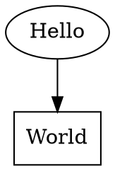

# sane-graph-edit

A act-by-keyboard move-by-mouse controlled, VIM-inspired desktop editor for small to medium graphs (thousands objects should be fine; no hardware acceleration). 

Meant for convenient information storage - like mind maps. Ergomy is the main goal. No fighting with cumbersome UI. You can draft a tree or a dependency graph roughly as fast as you can describe it out loud.

Example of editing:

- `v` or doubleclick to spawn a node.
- `Space + <write> + escape` to edit a node.
- `v` or `a` to create connected nodes.
- `e` to connect node under mouse from selected node. `E` to connect in reverse direction.
- ...

Selecting:

- Click to select, `Ctrl+click` to multi-select, `Ctrl+drag` to box-select.
- Search-based: `/` , type, `enter`.
- Hit `t` to select full subtree (of successors). `T` for predecessors.
- `l` to add one generation of neighbours. `w` to remove the oldest generation
- ...

Registers, macros, mappings:

- record vim macros with `q` + `<letter>` and replay with `@` + `<letter>`. 
- map stuff `map gh tih0<Esc>` - gh hides everything except subtree of the current node and moves view to it. (Mapping a `g<letter>` shadows the built-in meaning — `gf` follows links — and `link-<letter>` for that letter.)
- `m<letter>` + `'<letter>` mark graph subsets .
- some `:` commands.
- headless mode.
- ...

Saves in a DOT-like format, but full compatibility is not our goal.

Written in Kotlin + Swing, runs anywhere JDK 21 runs. (Yes, it *is* ugly, and hidpi support is bad.)

Originally written by me in 2022, finished with a heavy help of Claude Code. 

End of Human-written README. The rest is AI-generated, but I hope it's accurate and useful.

------------------------------

## Status

Being revived from a long-dormant "forgotten changes" state.
Buildable, runnable, but rough around the edges. See
[`tasks/roadmap.md`](tasks/roadmap.md) for the plan and
[`docs/developer/architecture.md`](docs/developer/architecture.md) for
the code-level picture.

## Install & run

### Quick start (requires JDK 21+)

```sh
git clone git@github.com:kareltucek/sane-graph-edit.git
cd sane-graph-edit
./gradlew run
```

Gradle downloads the right Kotlin compiler via the JVM toolchain
config; you only need a JDK 21 (or newer) on your `$PATH` or
managed by [sdkman](https://sdkman.io/).

`./gradlew run --args=examples/index.dot` is a place to start: a graph
whose nodes lead to the examples, the built-in help, this manual and the
file format. Select a node and press `gf`; `Ctrl+O` goes back.

### Fat jar (portable, ~2 MB)

```sh
./gradlew fatJar
java -jar build/libs/sane-graph-edit-*-all.jar
```

A single self-contained `.jar` you can copy to any machine with
JDK 21+. Rename it, put it on a USB stick, alias it in your
shell — whatever works.

### AppImage (recommended for Linux, ~54 MB, no Java dependency)

```sh
./gradlew appimage
```

Produces a single self-contained
`build/dist/sane-graph-edit-<version>-x86_64.AppImage` file.
`chmod +x` it and run — no installation needed, no Java needed on
the target machine.

```sh
chmod +x build/dist/sane-graph-edit-*-x86_64.AppImage
./build/dist/sane-graph-edit-*-x86_64.AppImage
```

Requires
[appimagetool](https://github.com/AppImage/appimagetool) on
`$PATH` or at `~/.local/bin/appimagetool`:

```sh
mkdir -p ~/.local/bin
wget -O ~/.local/bin/appimagetool \
  https://github.com/AppImage/appimagetool/releases/download/continuous/appimagetool-x86_64.AppImage
chmod +x ~/.local/bin/appimagetool
```

### Native app directory (no Java dependency, ~160 MB)

```sh
./gradlew jpackage
```

Produces `build/dist/sane-graph-edit/` — a directory containing a
native `bin/sane-graph-edit` launcher and a bundled JRE. Copy the
whole directory to `/opt`, `~/bin`, or wherever you keep local
apps. The user does **not** need Java installed.

```sh
# run it directly
build/dist/sane-graph-edit/bin/sane-graph-edit

# or install system-wide (also available via `make install`)
sudo cp -r build/dist/sane-graph-edit /opt/
sudo ln -sf /opt/sane-graph-edit/bin/sane-graph-edit /usr/local/bin/sane-graph-edit
```

For a `.deb` or `.rpm` installer instead of a plain directory:

```sh
./gradlew jpackage -Ptype=deb   # Debian/Ubuntu (.deb)
./gradlew jpackage -Ptype=rpm   # Fedora/RHEL (.rpm)
```

These require the corresponding packaging tools (`dpkg-deb` /
`rpmbuild`) to be installed.

### Headless / scripting

Run the editor without a window to automate exports and other
batch operations:

```sh
# Export a DOT file to SVG, no window, no user interaction
sane-graph-edit input.dot -e ':export output.svg<Enter>'

# Recall a persistent mark (A-Z), then export just those nodes
sane-graph-edit input.dot -e "'A" -e ':export-selection a.svg<Enter>'
```

Flags:
- `-e '<keys>'` — execute a key sequence and exit. Repeatable.
  The argument is whatever you'd type interactively:
  `':export foo.svg<Enter>'`, `"'A"`, `'dih'`, anything.
- `-u` — stay open with a window after running `-e`. Useful for
  pre-configuring a session.
- `[file]` — positional arg: DOT file to load on startup.
- `-h`, `--help` — usage.

### Development

```sh
./gradlew build          # compile + test + assemble
./gradlew test           # run unit tests only
./gradlew fatJar         # rebuild the fat jar
./gradlew jpackage       # rebuild the native app-image
```

## Using it

### Mouse

| Action                       | What it does                                       |
|------------------------------|----------------------------------------------------|
| Click a node                 | Select it (replaces current selection)             |
| `Ctrl` + click node          | Toggle that node in/out of the multi-selection     |
| `Ctrl` + click empty + drag  | Selection box — rubber-band adds to selection      |
| Drag a selected node         | Move the selection                                 |
| Drag on empty space          | Pan the view                                       |
| Double-click empty           | Create a new node                                  |
| Double-click a node          | Edit its text in place                             |
| Right-click                  | Open the colour / shape / size picker on hover node |
| Mouse wheel                  | Zoom in / out, centred on the cursor               |

### Keyboard — structural edits

| Key       | Action                                                          |
|-----------|-----------------------------------------------------------------|
| `e` / `E` | Connect selection → node under cursor (forward / backward)      |
| `v` / `V` | Spawn new node at cursor, connect from selection (fwd / bwd)    |
| `a` / `A` | Append new node + edge from the last active node                |
| `c`       | Clear edges (within selection, or incident to selection)        |
| `d`       | Delete selected nodes                                           |
| `D`       | Delete selected nodes but reconnect predecessors to successors  |
| `o` / `O` | Run layout optimiser (free / restricted around the drag node)   |
| `g`       | Toggle "grab" mode — move the selection without holding a button |

### Keyboard — selection & navigation

| Key        | Action                                                    |
|------------|-----------------------------------------------------------|
| `Ctrl+A`   | Select all / deselect all (toggle)                        |
| `Escape`   | Clear selection                                           |
| `t` / `T`  | Add the forward / backward reachable closure to selection |
| `l` / `L`  | Add one generation of neighbours (forward / backward)     |
| `w` / `W`  | Remove the "oldest" generation of the current selection   |
| `i`        | Invert selection (among visible nodes)                     |
| `h`        | Hide the selected nodes (levelled; use `ih` to keep only selection) |
| `H`        | Unhide one level (undo the most recent `h`)               |
| `0`        | Fit view to all visible (or to selection if any)          |
| `1`        | Centre view on selection                                  |
| `Space`    | Edit the text of the last active node                     |
| `Shift+Space` | Same, but replace selection with that node first       |

### What a node's text is: `content-type`

A node's text is plain unless its `content-type` attribute says
otherwise:

| `content-type` | The text is            | Shown, while not edited (Electron client)          |
|----------------|------------------------|-----------------------------------------------------|
| (none)         | plain text             | as it is                                            |
| `code-<lang>`  | code, e.g. `code-scala` | highlighted as neovim highlights that file type    |
| `code`         | code in no named language | as it is                                         |
| `markdown`     | markdown               | formatted; ` ```mermaid ` and ` ```dot ` blocks are drawn as diagrams |

`:content-type code-scala` (or `markdown`, `plain`, …) sets it for
the selected nodes; `:content-type` alone tells it. The language is
a neovim file type, and the node is edited as one. A node keeps the
size of its source text whatever is shown in it; a picture that
does not fit is scaled down. The Swing client keeps the attribute
and shows every node as text.

**Text kept in a file.** A type may be followed by `:` and where the
text is, written as a link is: `code-kotlin:src/A.kt:10-20` (lines),
`markdown:README.md#Depth` (a section of a markdown file),
`plain:notes.txt` (all of it). The node then shows what the file
holds, read when the graph is opened. All the nodes of all the open
graphs that speak of one file share one unsaved copy of it: nodes
that hold the same lines, or lines of one another, show one text,
and an edit of one is seen in the others when the editor is left. An
edit is a change of the graph like any other: it is undone like any
other, and saving the graph (`:w`) writes the file — all of it, with
what other open graphs changed in it. When a save changes how many
lines there are, the line numbers of the nodes below them follow, in
every graph that is open. A graph that is not open is not corrected:
name a section where you can. A file that another program changed
under an edit is not written over; `:e!` takes its text again.
The unsaved copy lives as long as the application: `:e` and closing
a tab leave it, `:wa` saves every graph and every such file, and
quitting asks about those that are still unsaved. `gf` on a text file opens such a node, and `:w` there
writes the file. This is a first version.

A node being edited in the Electron client is never bigger than the
part of it that is on the screen; beyond that neovim scrolls.

### Depth: `z`

A node can have a third coordinate, `z`, the third number of its
position (`pos="100,50,200!"`): how far it is behind the plane the
graph is drawn in, away from you, in the units of its position;
negative for a node in front of the plane. A node without one is in
the plane, and a graph without any looks as it always did. (An
attribute `z="200"` is read as well.)

The view looks straight at the graph. What is further away is drawn
smaller and nearer the middle of the view, what is nearer bigger;
what is behind you is not drawn, nor are its edges. At zoom 1 you
are 1000 units in front of the plane you look at, so a node 1000
units behind it is half its size. Zooming is coming closer: the
wheel over a node goes towards that node, whatever its depth, and
past the nodes in front of it. `examples/cube.dot` has one to try.

`:z 300` puts the selected nodes at that depth, `:z +50` and `:z -50`
move them by that much (away from you, towards you), `:z =-300` puts
them at a negative depth, and
`:z` alone tells where they are. A new node is made at the depth of
the plane you look at.

`:set 3d` turns 3D mode on (`:set no3d` off, `:set 3d!` toggles; the
status line shows `[3d]`). In 3D mode the middle button turns the
view around the selection, or around everything visible when nothing
is selected; `:view-front` turns it back. Nodes always face you. What
you do with the mouse then happens across the view as you see it:
a dragged node, grab, rotate, scale and mirror move nodes left,
right, up and down on your screen, which seen from the side is into
the graph; new and pasted nodes land in the plane you look at. In 2D
mode, the default, nothing turns the view, and a view that was
turned is shown from the front. The layout optimizer and the SVG
export know nothing of depth.

### Keyboard — `z`: view and folding

These act on the selection, or on the last active node when nothing
is selected.

| Key           | Action                                                      |
|---------------|-------------------------------------------------------------|
| `zz` / `z1`   | Centre the view on it (as `1`)                              |
| `z0`          | Fit the view to it (as `0`)                                 |
| `zt` / `zb`   | Move the view up or down so that it is at the top / bottom edge |
| `zs` / `ze`   | Move the view sideways so that it is at the left / right edge |
| `zf{motion}`  | Fold: hide the nodes the motion reaches                     |
| `zd{motion}`  | Unfold: show the nodes the motion reaches                   |
| `za{motion}`  | Toggle: unfold if the motion reaches a hidden node, else fold |
| `zi` / `zI`   | Toggle the children / everything downstream (`zal`, `zat`)  |
| `zo` / `zO`   | Toggle the parents / everything upstream (`zaL`, `zaT`)     |
| `zm` / `zr`   | Hide the selected nodes / unhide one level (`h`, `H`)       |
| `zR`          | Unhide everything                                           |

The edge commands keep the zoom and leave 40 pixels to the edge.
A motion is one of `t`, `T`, `l`, `L`: what it would add to the
selection is what is folded, hidden nodes included; whatever is
selected stays visible. Each fold is one undo step. As commands:
`:fold t`, `:unfold L`, `:toggle-fold select-closure-forward`.

Two modes change how hiding interacts with selection. Turn them on
with `:set <mode>`, off with `:set no<mode>`, toggle with
`:set <mode>!`. They apply to all tabs and show in the status bar
while on:

- `unhide` — `t`/`T`/`l`/`L` (and `G`) also step into hidden nodes,
  and unhide the ones they select (one undo step).
- `show-parents` / `show-children` — besides non-hidden nodes, also
  show selected nodes and every parent / child of a non-hidden or
  selected node. Display only; hide levels are untouched.
- `dynamic` — a node that becomes visible (by any of the above, or
  `H`) is moved next to its visible neighbours, left to right: a
  child in a column right of its parents, a parent left of its
  children, stacked vertically without overlapping anything visible.
  A real move: one undo step per batch, saved with the file.
- `discard` — never ask about unsaved changes: opening, following
  links, reloading, jumping, closing tabs and quitting discard them.

### Keyboard — styling

| Key        | Action                                                    |
|------------|-----------------------------------------------------------|
| `F`        | Copy style from the selected node to the "clipboard"      |
| `f`        | Paste the last-copied style onto the selected nodes       |

### Keyboard — history

| Key                   | Action                                           |
|-----------------------|--------------------------------------------------|
| `u` or `Ctrl+Z`       | Undo the last mutation                           |
| `U`, `Ctrl+Shift+Z`, or `Ctrl+R` | Redo                                  |

Undo covers every user-visible change: spawning / deleting nodes,
adding / removing edges, moving nodes (one step per drag, not per
pixel), typing into a node (one step per edit session, not per
keystroke), style / shape / size changes, and layout-optimiser runs.
Selection changes and view transforms are not tracked — they're
navigation, not data.

### Command line (`:`)

| Key            | Action                                                   |
|----------------|----------------------------------------------------------|
| `Tab`          | Complete: commands, `:set` settings (`:se` works too), `:help` topics, `:export` formats, paths for `:e` / `:w` / `:source` / `:browse` / `:cd`. Several matches: first the common prefix, then each Tab cycles |
| `Shift+Tab`    | Cycle backwards                                          |
| `Ctrl+D`       | List what Tab could complete to                          |
| `Up` / `Down`  | Command history                                          |

### Keyboard — files & export

| Key             | Action                                                 |
|-----------------|--------------------------------------------------------|
| `:open`         | Open into this tab — file chooser dialog               |
| `Ctrl+P`        | Pick a file with an external command (`:set picker=…`; default: xterm + fzf over `*.dot`), open it here (more lines: new tabs) |
| `Ctrl+O` / `Ctrl+I` | Jump back / forward (vim jump list): to where a `gf` / `g<letter>` / `:open` in this tab started, restoring selection and view |
| `Ctrl+S`        | Save — writes to the current file, prompts on first save |
| `Ctrl+Shift+S`  | Save As — always prompts                               |
| `F5`            | Reload the current file from disk (asks if unsaved). Undo brings back the graph as it was before the reload |
| `gf`            | Follow the selected node's `link` in this tab: open the file (and focus `:nodeid` if given), or show the directory's file tree |
| `g<letter>`     | Same for `link-<letter>`, unless `g<letter>` is mapped to something else. Without such a link it reports that and does nothing (it doesn't grab) — except `gx` / `gy` / `gs` / `gg`, which then grab |
| `gF`            | Same as `gf`, but into a new tab                       |
| `:browse [dir]` | New tab with a file tree of `dir` (default: working directory); `gf` on a node opens it. Files are one column right of their directory, subdirectories two; the tree is cut to the depth that fits the window, the last level being `name/ …`. The `help` node above the directory opens the key and command reference. `:tabnew` is `:browse` of the workspace |
| `:e <path>`     | Open a file in a new tab; a directory opens as its file tree (also from the open dialog and the command line) |
| `:file`         | Show the full path of the tab's file (or the browsed directory) |
| `:cd <dir>`     | Switch the workspace to `dir` (see [Workspaces](#workspaces)); bare `:cd` shows it |
| `Ctrl+E`        | Export graph as SVG                                    |
| `Ctrl+Shift+E`  | Export only the selected nodes as SVG                  |

On close, the editor prompts Save / Discard / Cancel for every
unsaved tab. Last-used open/save directories are remembered in
`~/.sanegrapedit.properties`.

The `Ctrl+P` picker runs `sh -c "<picker>"` in the background with
`SGE_DIR` (the workspace directory) and `SGE_FILE` set,
and opens the `path[:nodeid]` lines it prints (relative to
`SGE_DIR`). Opening a terminal is the command's job; a terminal's
stdout isn't the picker's, hence the temp file. E.g. st + television
in the init file:

```
set picker=out=$(mktemp); st -c sge-picker -e sh -c 'cd "$SGE_DIR" && tv --source-command "find . -name \"*.dot\"" > "$1"' sh "$out"; cat "$out"; rm -f "$out"
```

With i3, `for_window [class="sge-picker"] floating enable` makes it
a popup.

### Workspaces

The workspace is the working directory: the one the editor was
started in, until `:cd <dir>` switches it. Relative paths in the
`:` bar are relative to it, and each workspace has its own session.
`:cd` stores the open tabs in the session of the workspace being
left (asking about unsaved changes) and replaces them with those
of the new one. A workspace without open files in its session
starts with a file tree of its directory (`:browse`).

### Shared sessions

Windows are independent of each other, also when started in the
same directory. `sane-graph-edit --attach` instead joins the
*session* of the window already running in that directory (the
first one started there, if there are several): the two have their
own tabs, selection and view, but a file open in both is one
document — an edit, an undo or a save in one shows up in the other,
and undo steps back through the document's changes whoever made
them. While somebody else has the current document open too, the
status bar says `[shared]`.

If two changes collide, the one that names something already
deleted is refused, and where both touched the same node the owner's
stands; the refused change disappears with a message. When the
owner quits, the other windows carry on by themselves with what
they had.

The window that has a directory's session is the one that answers
at its socket, whichever client it is: a window of the Electron
client has it, is joined with `--attach` and is scripted with `ctl`
the same way, and a Swing window and an Electron window can share
one session.

### Scripting a running window (`ctl`)

A script or an agent can read and change the documents of a running
window (the first one started in the directory):

```sh
sane-graph-edit ctl documents            # what is open
sane-graph-edit ctl open other.dot       # show a file in a new tab (--here: in the current tab)
sane-graph-edit ctl state graph.dot      # nodes and edges by id, as JSON
sane-graph-edit ctl dot graph.dot        # the same as DOT, unsaved changes included
echo '{"setNodes": {"<id>": {"text": "New label"}}}' |
    sane-graph-edit ctl patch graph.dot  # change it; the window updates at once
sane-graph-edit ctl undo graph.dot
sane-graph-edit ctl save graph.dot
```

Run it in the window's workspace directory, or name it with
`--workspace <dir>`. A patch adds, changes and removes nodes and
edges by id; `sane-graph-edit ctl help` shows its form. The same
messages can be spoken directly over the session's socket (`ctl
socket` prints its path): JSON, one message per line — see
`docs/developer/architecture.md`.

### WebSocket (`--ws`)

For clients that cannot open a Unix socket, such as a browser,
`sane-graph-edit --ws <port>` also listens on a WebSocket (port 0:
any free one). It is off unless asked for, accepts connections from
this machine only, and only from clients that know the token in the
address. The window prints that address
(`ws://127.0.0.1:<port>/?token=…`) and keeps it, while it runs, in
the file beside the session's socket with `.ws` in place of
`.sock`. The messages are the same as on the socket, one per
WebSocket text message.

### Session persistence

The set of open file-backed tabs is persisted per workspace to
`$XDG_CONFIG_HOME/sane-graph-edit/workspaces/<dir>/session.properties`
(`$XDG_CONFIG_HOME` falls back to `~/.config`; `<dir>` is the
workspace path with `/` written as `%2F`) whenever
you open, close, or save a file — and one last time on window
close. On the next launch in that directory, those files are reopened
automatically and the tab that was active last time becomes active again.
The `init` file stays global.

Untitled tabs don't participate (there's no stable identifier to
restore them from), and the restore only reopens files *from
disk* — it does not recover unsaved edits. That's what the
autosave backup directory is for, and it is never touched
automatically by session restore.

### Autosave backups

Every 5 minutes, any dirty tab is written to
`$XDG_CACHE_HOME/sane-graph-edit/backups/` (defaults to
`~/.cache/sane-graph-edit/backups/`) as a plain DOT file with
the filename

```
<basename>.<hash>.<id>.dot
```

where `basename` is the source file's name without its `.dot`
extension (or `untitled` for tabs that have never been saved),
`hash` is a short SHA-1 prefix of the absolute source path (or
the tab's autosave UUID for untitled tabs) to disambiguate files
that share a basename, and `id` is a monotonically increasing
integer per `(basename, hash)` pair. Examples:

```
foo.3a1b9cd0.1.dot
foo.3a1b9cd0.2.dot
foo.3a1b9cd0.3.dot
untitled.8e7d2f4a.1.dot
```

**Backups accumulate and are never deleted automatically.** The
design goal is a safety net against your own saving mistakes: if
you overwrite the wrong file, save after a bad delete, or
clobber a graph with an empty document, the previous snapshots
are still sitting in the backup directory. Recovery is manual —
`ls ~/.cache/sane-graph-edit/backups/`, find the snapshot you
want, copy it into place. When the directory gets too large,
prune it yourself. The editor never auto-restores from this
directory; it's there when you need it, invisible when you
don't.

### Keyboard — tabs

| Key                | Action                                               |
|--------------------|------------------------------------------------------|
| `Ctrl+T` / `Ctrl+N` | Pick a file and open it in a new tab                |
| `Ctrl+W`           | Close current tab (prompt if unsaved)                |
| `Ctrl+Tab`         | Next tab                                             |
| `Ctrl+Shift+Tab`   | Previous tab                                         |
| `Ctrl+PageDown`    | Next tab (alias)                                     |
| `Ctrl+PageUp`      | Previous tab (alias)                                 |

Each tab owns its own graph, file path, undo history, and view
transform (pan / zoom). Closing the last tab clears it rather than
removing it — the window is never empty.

### Keyboard — clipboard

| Key        | Action                                                   |
|------------|----------------------------------------------------------|
| `Ctrl+C`   | Copy selected nodes (plus edges with both endpoints in)  |
| `Ctrl+X`   | Cut — copy and delete                                    |
| `Ctrl+V`   | Paste under the cursor                                   |

The clipboard is process-local and works across tabs: copy in one
tab, switch tabs, paste. Pasted nodes become the new selection so
they can be immediately repositioned or restyled.

## File format

Native format is a subset of [Graphviz
DOT](https://graphviz.org/doc/info/lang.html):



Attributes the editor understands and round-trips:

- `label` — node text
- `pos` — node position (with the trailing `!` for fixed placement)
- `fillcolor` / `color` — background / foreground
- `fontsize` — maps to an internal scale factor
- `shape` — `box` or `oval`
- `marks` — persistent marks
- `fontname` — `monospace` for source code
- `link-<letter>` / `link` — links to other graphs / nodes (`g<letter>`),
  or to lines of a source file (`file.scala:42`, `file.scala:40-60`)
- `attachTo` / `attachSide` — glue a node to a side of another one;
  it then moves, hides and lays out with its owner

Graph-level settings, unknown node / edge attributes and comments
are preserved on open/save. The full specification is in
[`docs/file-format.md`](docs/file-format.md).

## Why "sane" graph edit?

Most graph editors assume you want to *compose* a diagram out of
prefab pieces on a palette. If you just want to write down "A leads
to B, B and C both lead to D, by the way D is the interesting one",
you end up fighting the editor. This tool skips the palette and makes
the common operations — spawn a node, connect it, label it, move it —
one keystroke each.

## Contributing / hacking

- [`docs/developer/architecture.md`](docs/developer/architecture.md)
  is the orientation document. Read it first.
- [`tasks/`](tasks/) holds the design plans for in-flight features.
- Top-level types (`Graph`, `Plotter`, `GraphView`, `GraphKeyListener`,
  `DotGraphLoader`) have KDoc pointing at the relevant sections.

## Licence

Copyright (C) 2026 Karel Tuček

Licensed under GNU GPLv3. 
