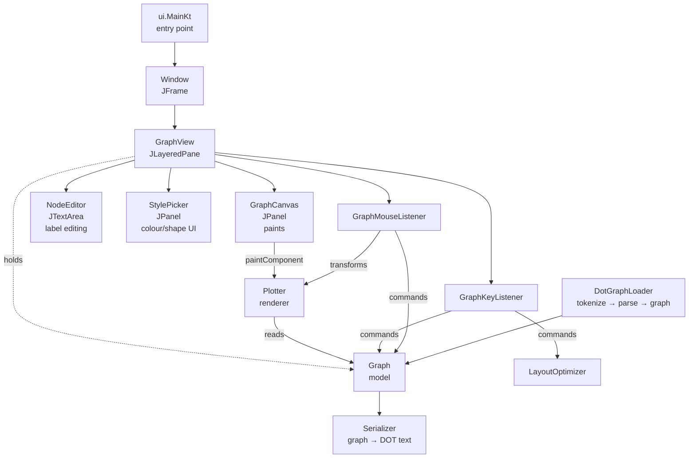
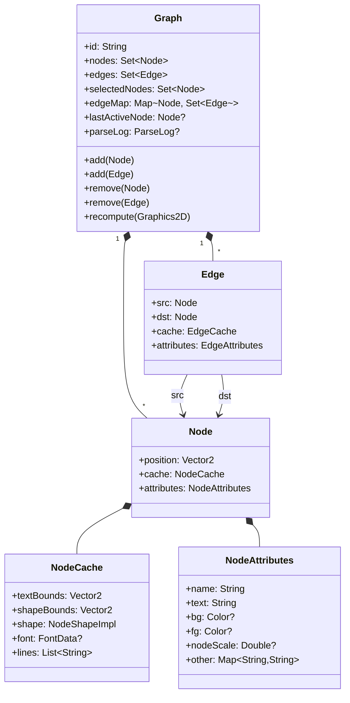
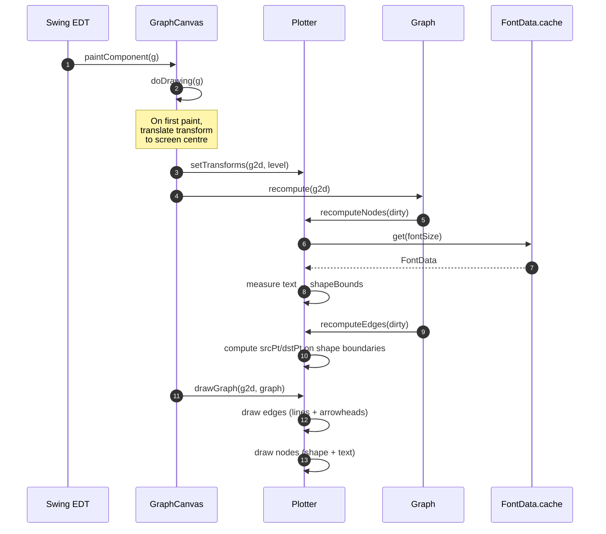
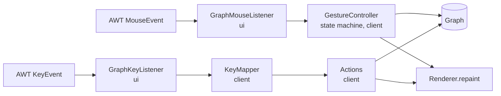
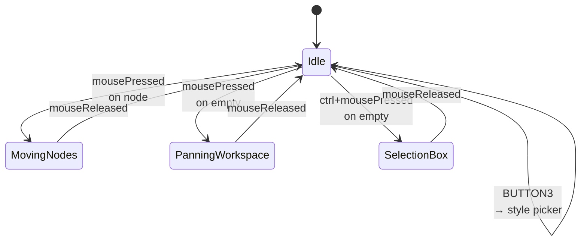
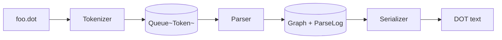
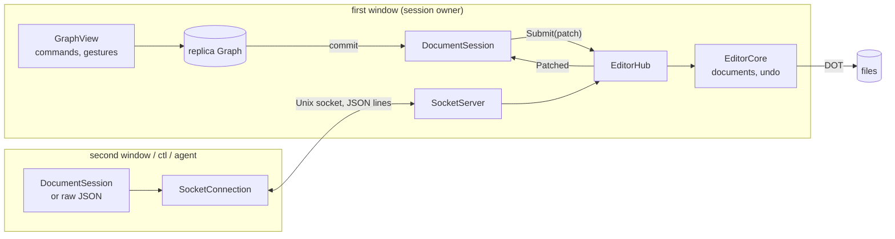
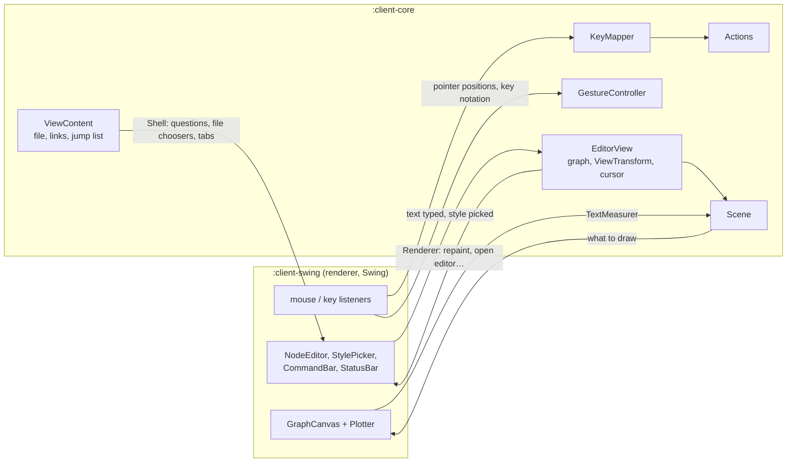

# Architecture

> Intended audience: future contributors (including future-me) who
> want to change code in this repo. This file is meant to be read
> top-to-bottom once, and then skimmed for specific sections. It
> lives under version control because it will age and need updates.

Diagrams are [Mermaid](https://mermaid.js.org/) and render in
Obsidian, GitHub, and most markdown viewers.

## The 30-second summary

`sane-graph-edit` is a **desktop graph editor** written in
**Kotlin + Swing**. You draw nodes by double-clicking, you connect
them with keyboard shortcuts (`e`, `v`, `a`), you pan with drag and
zoom with the wheel, and you save as [Graphviz
DOT](https://graphviz.org/doc/info/lang.html). That's the whole
product.

Under the hood there are five Gradle subprojects, each in a
directory of its name under `modules/`:

| Subproject     | Role                                               |
|----------------|----------------------------------------------------|
| `:model`       | Data model (`graph_tools`: `Graph`, `Node`, `Edge`, commands, layout), DOT (`parser_dot`), SVG (`export`), and what clients and the editor exchange (`sync`). No AWT. |
| `:editor-core` | The authoritative side of a session: documents, order of changes, undo (`editor`). Pure logic, no threads or IO. |
| `:client-core` | A client of a session, without a GUI: replicas of its open documents, and everything about editing that is per user — commands, gestures, key mapping, the `:` command line, what a view shows (`client`). No AWT. |
| `:editor-host` | Runs an editor on the JVM: files, in-process and socket connections (`host`). |
| `:client-swing` | The Swing renderer and application: widgets, AWT event translation, tabs, dialogs (`ui`), painting (`graph_tools.Plotter`). |

`:model`, `:editor-core` and `:client-core` are Kotlin Multiplatform
subprojects with two targets, the JVM and JavaScript for Node.js;
`:editor-host` and `:client-swing` are JVM only. The root project
holds no code; the jar and the packages are still built into its
`build/`. Their code is in
`src/commonMain`; what differs per platform is behind three
`expect` objects with a JVM and a JavaScript implementation each:

- `utils.Platform` (model): time, fixed-point number formatting,
  a process-wide counter, reading and writing a text file.
- `client.Path` and `client.Fs`: paths and the file system. On the
  JVM `client.Path` *is* `java.nio.file.Path` (a typealias), so
  JVM code passes its paths to the client unchanged.
- `client.AppState`: what is remembered between runs.

JVM only, in `modules/client-core/src/jvmMain`: the Unix-socket connection, the
session and preferences files, XDG paths. JavaScript has
`client.WebSocketConnection` (`modules/client-core/src/jsMain`) as its transport
and needs its own storage.

Tests in `commonTest` run on both targets (`./gradlew allTests`;
the first run downloads Node.js and a test runner). Their names
contain spaces, which this Kotlin version refuses for JavaScript,
hence `@file:Suppress("NAME_CONTAINS_ILLEGAL_CHARS")` at the top of
each; the names work at run time.

See [Sessions: editor and clients](#sessions-editor-and-clients)
for how they work together.

## Top-level component map



The arrow from `GraphCanvas` to `Plotter` is the **read-only
rendering path**. Every other arrow is a **mutation** or a
**handoff**.

## Data model



A few things worth calling out:

- **`cache` is derived state.** It stores layout measurements
  (bounds, font, line splits, edge endpoints) that the renderer
  depends on but are expensive to recompute. The contract is: after
  mutating a node's `attributes` or `position`, you call
  `Graph.needsRecomputing(node)`. The next `Graph.recompute(g2d)`
  call will refresh everything marked dirty. `GraphCanvas.doDrawing`
  calls `recompute()` on every paint — so you rarely need to think
  about it explicitly as long as you mark the dirty node.

- **Edge identity is referential.** `Edge` has no `equals`/`hashCode`
  overrides (there's commented-out code from a past attempt — see
  `Edge.kt:32-47`). Two edges with the same src/dst are distinct
  objects. This matters for undo (restoring removed edges needs the
  same object) and for allowing multi-edges.

- **`lastActiveNode` is both "cursor" and "anchor".** It tracks the
  most recently touched node so that keystrokes like `Space` (edit)
  and `a` (append with edge) know what to act on when the mouse
  isn't involved. It is not the same thing as a single selection.

## Rendering pipeline



### Coordinate systems

There are two:

- **Workspace** (world) — the logical graph coordinates stored in
  `Node.position`. Invariant across zoom/pan.
- **Screenspace** — AWT pixel coordinates inside `GraphCanvas`.

The mapping is the view's own `client.ViewTransform` (a zoom and
an offset; `EditorView.viewTransform`), with `toWorkspace(screen)`
and `toScreen(workspace)`. There is no global transform: whoever
converts takes the transform of the view it works on, and the
painter is handed it at the start of each paint.

### Font caching

Font measurement via `FontMetrics` is surprisingly expensive at
scale, and `Graphics2D`'s current transform leaks into metric
calculations — a zero or tiny transform corrupts measurements.

`FontData.cache` (in `Plotter.kt:175+`) keeps font-metric entries
keyed by font size (a `Double`). Every lookup wraps the metric
calculation in `g2d.withIdentityTransform { … }` so the measurement
is always taken at "scale 1". The bug that motivated this cache is
memorialised in commit `5e1e2f4`.

### Optimisation levels

`GraphCanvas.optimizeLevel` starts at 0. If a frame takes longer
than `50 + 50 * level` ms (see the `withPerformanceCheck` wrapper in
`utils.Utils.PerformanceData`), the level bumps up and the next
frame drops features:

| Level | What it drops                                    |
|-------|--------------------------------------------------|
| 0     | nothing                                          |
| 1     | antialiasing during pan                          |
| 2     | antialiasing even while still                    |
| 3     | arrowhead ovals (draws plain squares)            |
| ≥3    | text rendering below a zoom threshold (see `drawNode`) |

There's no "undo" for the level — once bumped, it stays up.

## Input handling



The two listeners only translate AWT events (positions, key
notation); everything they feed is toolkit-free and lives in
`:client-core` — see [Client and renderer](#client-and-renderer).

### `GraphMouseController` states



### Keyboard commands

`client.KeyMapper` resolves key sequences to command names,
`ui.CommandRegistry` maps the names to `client.Actions` functions
(or to `client.ViewContent` and the tab functions). The canonical list:

| Key    | Action                                                 |
|--------|--------------------------------------------------------|
| `e`/`E`| draw edge from selection to node under cursor (fwd/bwd) |
| `v`/`V`| new node + edge from selection                         |
| `a`/`A`| append new node + edge from last active                |
| `c`    | clear edges                                            |
| `d`/`D`| delete (with/without reconnect)                        |
| `o`/`O`| layout optimise                                        |
| `t`/`T`| select reachable closure (forward/backward)            |
| `l`/`L`| select one generation of neighbours                   |
| `w`/`W`| unselect oldest generation                             |
| `f`/`F`| paste/copy node style                                  |
| `u`    | undo the last mutation                                 |
| `r`    | redo the last undone mutation                          |
| `g`    | toggle "grab and move" state                           |
| `0`    | fit view to all / selection                            |
| `1`    | centre view on selection                               |

Ctrl-modified shortcuts go through `keyPressed` instead of
`keyTyped`: `Ctrl+S` save, `Ctrl+O` / `Ctrl+I` jump back / forward, `Ctrl+R` redo, `Ctrl+A`
select-all, `Escape` deselect, `Space` edit active node.

See `Constants.helpCommands` for the in-app help text.

## DOT parsing / serialization



The tokenizer and parser are hand-written, not generated. Key
files:

- `parser_dot/Tokenizer.kt` — produces `Token(TokenType, value)`
- `parser_dot/Parser.kt` — consumes tokens, emits `Graph`
- `parser_dot/ParseLog.kt` — records `LogAction`s (comments,
  section breaks, node/edge declarations) so that the serializer
  can produce output that preserves structure on round-trip
- `parser_dot/Serializer.kt` — walks the `ParseLog` to emit DOT,
  with fallbacks for newly-added graph content not in the log
- `parser_dot/DotGraphLoader.kt` — top-level façade + file IO +
  an embedded ad-hoc test in `object Test`

Supported node attributes (round-trip fidelity):

| DOT attribute | `Node` field                |
|---------------|-----------------------------|
| `label`       | `attributes.text`           |
| `fillcolor`   | `attributes.bg`             |
| `color`       | `attributes.fg`             |
| `pos`         | `position` (with trailing `!`) |
| `fontsize`    | derived into `nodeScale`    |
| `shape`       | `cache.shape` (oval / box)  |

Everything else ends up in `NodeAttributes.other` and round-trips
verbatim.

## Layout optimiser

`graph_tools/LayoutOptimizer.kt` is a force-directed layout.
One pass gathers three kinds of spring force, averages them per
node, and applies one position update:

| Spring        | Function                  | Fires on       | Effect                                         |
|---------------|---------------------------|----------------|------------------------------------------------|
| **BB**        | `computeBBSpring`         | each edge      | Pulls both endpoints toward a target distance derived from the nodes' shape boundaries. "BB" = bounding-box boundary. |
| **Collision** | `computeCollisionSpring`  | every node pair | Pushes apart pairs closer than `sum-of-radii × distanceCf × springScale`. Keeps unconnected nodes from stacking.     |
| **Gravity**   | `computeGravitySpring`    | each node with in-edges | Aligns a node with the direction of its incoming edges. Keeps chains of edges pointing consistently.        |
| **Uniform-out** | `computeUniformOutSprings` | each node with ≥ 2 outgoing edges | Pulls the destinations toward the average outgoing-edge length along their current radial direction. Sibling edges settle to the same length. |

`compute()` flattens the three lists, groups by target node,
averages the per-node vector, and adds it to the position. One
call = one nudge.

**`springScale`** (session-wide, tuneable with `-`/`=`)
multiplies both the BB target distance and the collision
threshold, so the whole graph breathes together when the user
adjusts it. Collision threshold is floored at `1.0 × sum-of-radii`
so nodes can touch but not overlap regardless of scale.

**`SpringTarget`** controls *which* nodes get moved. Empty
selection relaxes everything (`MoveEveryone`); non-empty
selection relaxes only the selected nodes (`MoveSelectedOnly`)
but still considers cross-boundary edges as pulls on the
selected end. See `SpringTarget.fromContext` for the full
decision table.

Triggered by:

- `o` / `O` keybinding — one-shot layout pass (same result
  for both after the anchor fix).
- `-` / `=` — adjust `springScale`, then one pass.
- `optimizeOnDrag` flag — layout every mouse-move event while
  dragging.

Good for tidying a graph you've hand-drawn, not for producing a
canonical layout from scratch. Collision is O(n²) per pass —
fine for hundreds of nodes, slow for thousands.

## Undo / redo

`graph_tools/History.kt` defines a `Command` interface and a bounded
stack; `graph_tools/Commands.kt` holds the concrete commands
(`AddNodeCommand`, `RemoveEdgesCommand`, `MoveNodesCommand`,
`EditTextCommand`, `StyleNodesCommand`, `SetShapeCommand`,
`SetSizeCommand`, plus `CompositeCommand` for grouping). Each
`Graph` owns one `History` instance, so a per-graph (and
eventually per-tab) undo stack falls out naturally.

Rule of thumb when adding a new mutation:

1. Write a `Command` that holds the before/after state.
2. Call `graph.commit(cmd)` (runs redo + records it) for
   instantaneous mutations, or `graph.commitApplied(cmd)`
   for mutations that happen live during a user gesture (like node
   drag — the positions are already updated by the time you commit).
   Undo and redo are `graph.undo()` / `graph.redo()`. Don't reach
   into `graph.history`: in the application a graph is a replica
   of an editor's document and its own history stays empty (next
   section).
3. Leave the low-level mutators on `Graph` (`add`, `remove`,
   `addAllEdges`) alone: they stay off-the-record so the DOT parser
   can populate a fresh graph without spamming the history.

Drag coalescing is a "per-gesture transaction", not time-windowed:
`GraphMouseController` snapshots positions on `startMove*` and
commits once on release. Text edits coalesce within a 1-second
window by `EditTextCommand.coalesceInto`.

## Sessions: editor and clients

A document is not owned by the view that shows it but by an
*editor*, and every view works on a *replica*. That is what lets a
second window or a script edit the same document.



**What crosses the boundary** (`sync/Protocol.kt`) is only shared
document state. Selection, pan/zoom, view modes, the gesture in
progress and the layout optimiser all stay in the client. The one
exception is `Show` (`ctl open`): a request to show a file to the
user, which the editor only relays to the session's owner.

**State and patches** (`sync/GraphState.kt`). `GraphState` is a
document as plain data: a map of fields (`pos`, `text`, `bg`,
`attr:<dot attribute>`, …) per node id, endpoints and fields per
edge id. `Patch` is the one kind of change: add / remove nodes and
edges, set fields. Ids (`Node.id`, `Edge.id`) are session
identifiers, unrelated to DOT names — the DOT name is the field
`name`.

**A change, end to end:**

1. Code calls `graph.commit(cmd)` as always. The graph's
   `Committer` is its `DocumentSession`.
2. The session runs the command on the replica, takes the
   difference of the state before and after as a `Patch`, and sends
   `Submit(document, opId, baseRevision, patch)`.
3. `EditorCore` checks it (below), applies it to its `GraphState`,
   pushes patch + reverse patch on the document's undo stack and
   answers `Patched(revision, patch, origin, opId)` to every
   attached client.
4. Each client applies the patch to its replica
   (`Graph.applyPatch`, which keeps node objects and so the
   selection) and re-applies its own not yet answered patches on
   top.

**Conflicts.** A patch is applied when everything it names still
exists; otherwise it is `Rejected` and the client replaces its
replica's content with the editor's. A patch by a client other than
the owner (the first to connect, i.e. the window running the
editor) is also rejected when it touches a node or edge the owner
changed after the patch's `baseRevision`. Different fields of one
node changed at the same time both survive.

**Undo** is one stack per document, shared by all clients; `Undo` /
`Redo` are requests, their effect arrives as a `Patched`.
Successive patches by one client that set exactly the same fields
within a second merge into one step (typing, nudging).

**Files** belong to the editor. It parses DOT into a `GraphState`,
keeps the `ParseLog` and the graph name aside, and re-attaches them
to a `Graph` built from the state when saving — so comments and
order survive although clients never see them.

**Threads.** `EditorCore` and `EditorHub` have none: the host calls
them from one thread — the Swing event thread in the application.
`SocketServer` and `SocketConnection` have reader threads that hand
everything over to that thread (`onEditorThread`,
`onClientThread`). A `call` may block the event thread waiting for
its answer; the answer comes from the reader thread directly.

**The wire** (`Wire` in `sync/Protocol.kt`): one JSON object per
line. A client sends `{"id": 1, "request": {"type": "open", "path":
"/abs/x.dot"}, "call": true}`; the editor first greets with
`{"client": "c1", "owner": false}`, answers calls with
`{"replyTo": 1, "event": {...}}` and sends other events as
`{"event": {...}}`. Request types: `open`, `create`, `attach`,
`detach`, `documents`, `submit`, `undo`, `redo`, `save`, `reload`.
The socket is at `$XDG_RUNTIME_DIR/sane-graph-edit/<hash of the
workspace directory>.sock` (`client/SessionSocket.kt`).

**WebSocket** (`host/WebSocketServer.kt`, started by `--ws <port>`):
the same messages, one per text frame, for clients that cannot open
a Unix socket. Both servers share `servePeer` (`host/Peer.kt`),
which is all a further transport would have to call. The server is
written against the JDK alone (handshake and frames by hand; the
JDK has a WebSocket client but no server). It listens on
`127.0.0.1` only and refuses a handshake without the token: any web
page may connect to a local port, and the protocol can read and
write files. The address with the token is printed and written to
`<hash>.ws` beside the socket.

**Clients that cannot wait.** JavaScript has no way to block for an
answer, so `EditorConnection.call` throws on
`WebSocketConnection`. `EditorConnection.request(request,
onAnswer)` is the form that works everywhere, with
`EditorClient.open(path, then)` and `DocumentSession.save(path,
then)` built on it. The rest of the client (`ViewContent`'s file
handling, `EditorClient.create`) still uses `call` and so runs on
the JVM only for now.

**Testing across the two runtimes.** `modules/client-core/src/jsTest` runs the
Kotlin/JS client on Node against a real editor: each test starts
`host.TestEditor` (in the tests of `:editor-host`) as a JVM process;
the build script of `:client-core` hands it the Java binary and classpath.
`WebSocketServerTest` checks the server against the JDK's client.

**Without a session.** `ui.Editor.client` is null in unit tests; a
`GraphView` then edits a plain `Graph` with its own `History`. The
Gradle task `sessionTest` runs the application's tests a second
time with a session, so both paths stay covered.

## Client and renderer

The second boundary runs inside a client, between what is per user
but needs no GUI toolkit and the toolkit code that shows it and
takes input. Everything transient — panning, a drag in progress,
the selection — stays on the client's side of the session boundary
above and is handled here.



- **`EditorView`** is one view of a document as the client sees
  it: the replica graph, its `ViewTransform`, the cursor, the
  `GestureController`. `GraphView` holds one as `model`.
- **`Renderer`** is what the client asks of the GUI: repaint,
  refresh the status line, open / close the node editor and the
  style picker. One-way calls, nodes named by id. `GraphView`
  implements it; `NoRenderer` in the client's tests does nothing,
  which is how commands and gestures are tested without Swing.
- **`Scene`** is what a view shows, as plain data: visible nodes
  and edges in drawing order and the selection rectangle.
  `EditorView.scene(measurer)` builds it; `Plotter.drawScene`
  paints it and never sees a `Graph`. Text is measured by the
  renderer through the `TextMeasurer` it passes in.
- **Input** arrives as toolkit-free values: positions as
  `Vector2`, keys in `KeyNotation` (`ui.AwtKeys` converts AWT
  events). The node editor and the style picker report what was
  typed or picked (`EditorView.textTyped`, `Actions.colorSelection`
  …); the client changes the graph.
- **`ViewContent`** (`EditorView.content`) is what a view shows
  and where it came from: a graph file, a directory tree, lines of
  a source file. Opening, saving, reloading, following links and
  the jump list are here.
- **`Shell`** is what the client asks of the application around
  the view: messages, yes/no questions, file choosers, other tabs,
  quitting. `GraphView` implements it with Swing dialogs and the
  `TabManager`; the client's tests script the user's answers.
  **`Scheduler`** is the timer for key-sequence timeouts
  (`ui.SwingScheduler`).

Three calls across this boundary wait for a result: measuring
text, `Shell.confirm` and the `Shell.choose…` file choosers. They
pass plain data, so a renderer in another process stays possible,
but each would have to become a request and a reply there.

Per user, yet not per view: the view modes (`graph_tools.ViewModes`,
`:set unhide` …) are one set for the whole client process, and the
selection is stored on the client's replica `Graph`. Neither is
shared with other clients.

## Tabs and file handling

`ui/TabManager.kt` owns a `JTabbedPane` and the list of open
`GraphView`s. Each tab is one view: its own `Graph` replica, its
own file and unsaved-changes flag (`client.ViewContent`), and its
own `viewTransform`.

Closing the last tab resets it to an empty untitled document
rather than removing it, so the window is never empty. Closing
the window walks every tab and prompts Save / Discard / Cancel
for each dirty one before letting the process exit.

`ui/FileOps.kt` wraps `JFileChooser` for open and save-as dialogs.
`ui/AppState.kt` stores the last-used open and save directories
in `~/.sanegrapedit.properties` so dialogs start somewhere useful.

Cross-tab copy/paste uses a process-global `ui.Clipboard` holding
a `NodeFragment` (cloned nodes + edges where both endpoints are
in the selection + reference point for paste positioning). Paste
commits a `CompositeCommand(AddNodesCommand + AddEdgesCommand)`
so it's undoable.

### Session persistence

`ui/Session.kt` persists the ordered list of file-backed tabs
and the active tab path, per workspace, to
`$XDG_CONFIG_HOME/sane-graph-edit/workspaces/<dir>/session.properties`
(via `ui/Workspace.kt`, which holds the working directory — the
JVM's own can't be changed, so code must use `Workspace.dir`).
`TabManager.bootstrap()` reads it at startup and after `:cd`
(`switchWorkspace`) and reopens every file that still exists and
parses; failures are skipped with a stderr warning. With nothing
to reopen it browses the workspace directory. `TabManager.saveSession()` is
called on tab open/close/save and on window close.

Untitled tabs are intentionally omitted from the session — there
is no stable identifier to restore them from, and their
in-flight work is a different problem (see autosave backups,
below). The restore path only reopens files *from disk*; it
never touches the backup directory.

### Autosave backups

`ui/AutosaveManager.kt` runs a daemon `Timer` every 5 minutes
(`DEFAULT_INTERVAL_MS`) that writes every dirty `GraphView` to
`$XDG_CACHE_HOME/sane-graph-edit/backups/` (via `ui/XdgPaths.kt`)
as a plain DOT file with the name

```
<basename>.<hash>.<id>.dot
```

- `basename` is `currentFile.fileName` with the `.dot` suffix
  removed, or `untitled` for tabs that have never been saved.
- `hash` is the first 8 hex chars of `SHA-1(absolute source
  path)` for file-backed tabs, or the first 8 chars of the
  tab's autosave UUID for untitled tabs.
- `id` is a monotonically increasing integer per
  `(basename, hash)` prefix, allocated by `BackupIdAllocator`.

Filename construction lives in the pure `BackupPaths` object
(`basenameFor`, `hashFor`, `prefixFor`, `filenameFor`,
`parseFilename`) so tests can exercise the scheme without a tab
manager. `BackupIdAllocator` owns the counter state: it seeds
itself lazily by scanning the backup directory for existing
snapshots on the first lookup for a given prefix, so ids keep
climbing across editor restarts.

**Backups are never deleted automatically.** There is no
`deleteBackup` method, no cleanup on save, no cleanup on tab
close. The design goal is an accumulating safety net against
the user's own saving mistakes; pruning is the user's job.
Recovery is likewise manual — find the desired `.dot` file
under `~/.cache/sane-graph-edit/backups/` and copy it into
place. The two persistence layers are intentionally separate:
session restore reopens *files*, backups hold *content
snapshots*, and neither automatically crosses into the other's
job.

All IO in this path is best-effort: a failing backup write (disk
full, permission denied) never kills the editor, and a missing
backup directory is treated as empty rather than an error.

## What is *not* in the box

Items currently missing and planned under `tasks/`:

- **SVG export** — no export at all. See `tasks/svg-export.md`.
- **Broader test coverage** — we have unit tests for history and
  the clipboard (`modules/client-swing/src/test/kotlin/`), but the renderer, the input
  layer, and the DOT parser still rely on manual testing.

## Gotchas and legacy quirks

- **`Graph.findEdge` is O(n)** (`Graph.kt:144` has a
  `// todo: optimize this!`). For the graph sizes this tool targets
  (<1000 nodes) it's fine.
- **`GraphMouseListener` has a `// Todo: refactor this!`** at the
  top. The file is 312 lines of state-machine-by-convention.
  Leave it alone until there's a concrete reason to touch it; an
  input refactor is its own project.
- **`Graph.testGraph()`** still exists as a seed fixture but no
  longer runs on startup — fresh tabs are empty. Useful for
  manual inspection and for tests.
- **`ViewModes` is still a global** (`:set unhide` and friends),
  shared by all views of a process, like vim options. `Graph`
  also still carries the selection: fine while every client has
  its own replica, but neither is state the editor should see.

## Where to start when making changes

1. Running the editor: `./gradlew run`.
2. Changing input behaviour: `client.Actions` (commands),
   `client.GestureController` (mouse gestures) or
   `client.KeyMapper` (keys, `:` commands).
3. Changing how things look: `graph_tools/Plotter.kt` (renderer) or
   `graph_tools/NodeShape.kt` (shape primitives).
4. Changing what gets saved: `parser_dot/Serializer.kt` + the
   `applyAttribute` / `retrieveAttributes` pair in `Node.kt`.
5. Changing the window layout: `ui/GraphView.kt` (it's the
   `JLayeredPane` holding canvas, editor, and style picker).
