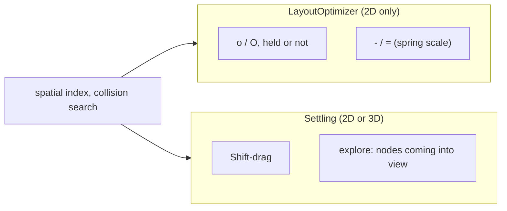
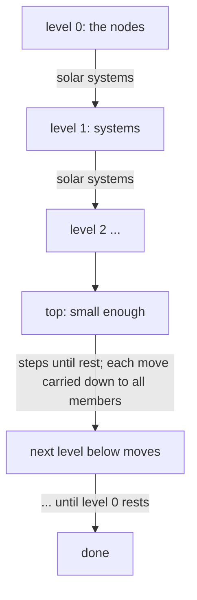

# Springs: one system, its parts, and the features that use it

Status: **specification for review** (2026-10-14). "Now" says what the code
does today; "To be" is the proposal. Numbers marked *(guess)* were chosen
by me and not tuned with Karel.

## 1. Today: two spring systems

- `LayoutOptimizer`: one pass = every spring of every moving node,
  averaged, applied in full (times the time share, §3). No damping, no
  weights, no depth.
- `Settling`: steps with damping, weights, pushes before pulls, origins,
  depth in 3D mode. Built for explore, then Shift-drag.

**To be:** one system (the settling). Features differ only in the
parameters of §4, not in code paths.

## 2. The springs

Each spring says, for one node, where it would like to be moved in one
window (§3). In 3D mode all are in space (`Node.point`), nodes counted as
flat cards facing the viewer: the outline across the plane, half the
smaller side deep. In 2D mode they are in the plane and depth never
changes.

| Spring | What it does | Parameters (now) |
|---|---|---|
| **collision** | two nodes nearer than a distance push apart | distance = touching × reach; reach 2 × `spring-scale` (optimizer, explore), 1.15 (Shift-drag: "only off each other") |
| **edge** | the two ends of an edge to a length | length = both reaches toward each other × `spring-scale` × degree factor (1 + 0.2 × smaller degree, +1 above 2) |
| **equal siblings** | the edges out of one parent to the same length | half the difference |
| **antigravity** (Karel's original "gravity") | a child pushed on along the way its parent came, kept at its distance | 10 units / window; only for parents with < 3 children (optimizer); settling: 3D mode only |
| **gravity** | a child pulled to lie from its parent the way the graph's edges go on average | 0.1 of the way / window *(guess)*; settling only |
| **origin** | back to where it was / where the document has it | at most 40 units / window; counts 0.3 while pushed |
| **follow** (firm origin) | a descendant of dragged nodes to its old place relative to them | 95 % of the way in 2 s; on top of the rest; 0.3 while pushed |
| **across** (3D) | two nodes on each other also go apart across the plane, along (way between them) × (way from parent); siblings to opposite sides | 0.3 of the push *(guess)*; 3D mode only |

## 3. How a step combines them

- **Time.** A spring asks for the move of one window of 16 ms (one
  picture at 60 a second). A step moves for the time since the last one,
  at most a window; a node that waited for its turn catches up, no
  further than its springs ask.
- **Pushes before pulls** (settling): pushes and pulls are averaged
  apart; while a node is pushed its pulls count 0.3.
- **Weights** (settling): of two nodes on each other each takes the
  other's share of their weights: fixed (∞) > heavy 4 > usual 2 > light 1.
- **Damping** (settling): a step moves 0.6 of what is asked, less over
  time (× 0.985 per window); the follow spring does not cool.
- **Joining**: a node pushed by one that moves joins the moving ones,
  unless fixed.
- **Collisions with the 16 nearest** only (found in a grid as fine as the
  nodes are dense): a pile costs about as much as its nodes, not their
  square.
- **Budget** (Shift-drag, `o`): a step stops after 50 ms; the nodes it took
  move for the others (× all / taken), but by that extra no further than
  their own size.
- **`o` by importance**: (children + 1) × size is both its weight (the
  less important give way) and its order (the most important first).
- **Rest**: when nothing moved more than 0.5 per window over a round and
  no follower is more than 2 from its place; then a last pass that only
  pushes apart (to 1.15 × touching); at most 200 rounds each.
- **Optimizer (now)**: all springs of a node averaged together, applied
  in full; no weights, damping, joining or rest.

## 4. The features

| Feature | Moves | Fixed | Springs | Depth | Ends | Undo |
|---|---|---|---|---|---|---|
| **o held** | selection, or all | the rest | *now:* collision, edge, equal siblings, antigravity | *now:* never | key let go | one step |
| **o not held** (macro, mapping, `:optimize`) | as held | as held | as held | as held | after 20 ms of time | one step |
| **O** on one node | its leaf children | the node, its parents, the rest | as `o` | as `o` | as `o` | one step |
| **O** on several | as `o` | as `o` | as `o` | as `o` | as `o` | one step |
| **Shift-drag** | dragged: exactly with the pointer; followers (descendants with no parent outside): heavy; nodes on them: usual; ghosts: light | — | collision (1.15), edge, equal siblings, origin (back), follow, gravity; 3D: across, antigravity | 3D mode | rest, or another gesture/command (they stop) | one step at rest |
| **explore: nodes coming into view** | them: usual; ghosts in the way: light | pinned nodes | collision (2), edge, equal siblings, origin (where the document has them relative to their neighbours), gravity | never | rest, at once (not animated) | none (explore) |

Not springs: explore's arrangement of roots in columns, `:set dynamic`'s
columns, the fold onto room walls.

## 5. To be (agreed 2026-10-14; built the same day — §4's "now" columns for `o` are history)

- **`o` on the settling.** Held: a run over the selection (all, none
  selected), one step per picture until the key is let go; not held: 20 ms
  of time at once. Only the selection moves: every other node is fixed
  and does not join.
- **`O` on one node:** the run moves its leaf children; the node and the
  rest are fixed.
- **Springs for `o`:** collision (2), edge, equal siblings, gravity,
  antigravity; in 3D mode in space, with across. No origin.
- **Antigravity in both modes** for `o` and Shift-drag.
- **3D mode is sparser:** collision and edge distances × 3 (Karel, after 1.5), every feature.
- **Explore in 3D mode settles in space** (with a strong gravity later).
- The optimizer (`LayoutOptimizer`) keeps only what the settling uses from
  it (spring helpers, collision search).

## 6. Questions for Karel

1. ~~`o`: should nodes not selected that the selection runs into make way
   (join as light), or stay fixed as now?~~ **Karel: they stay fixed; only
   the selection moves.**
2. ~~`o` gentler than the optimizer's full pass?~~ **Keep the settling's
   step for now; we will see.**
3. ~~Antigravity in 2D?~~ **In both modes, for `o` and Shift-drag.**
4. ~~3D sparseness?~~ **Yes: collision and edge distances × 1.5 in 3D mode,
   every feature.**
5. ~~Explore in 3D?~~ **Yes, in space. A strong gravity there probably, but
   later.**
6. ~~Gravity 0.1, across 0.3?~~ **Fine for now; tuned by trying.**

`- / =` now change the level of detail: no springs (removed from §4).

## 7. Multilevel: contract, settle, unpack (agreed and built 2026-10-14: `Multilevel`)

Karel: contract clusters until the graph is small, run the springs on it
with volume-based multipliers, carry each cluster's move to its members,
recurse; once the top level settles, continue with the levels below.

Only for `o` on the whole graph (Karel: how collisions would work on a
part of a decomposed graph is unclear).

### Mass (mass first, springs from the masses; Karel's revision)

- **Mass = the room a node wants:** (its reach × its furthest spring,
  × 3 in 3D mode)^d, d = 2 or 3; a node's reach averaged over the ways
  (its outline as a square of the same area; in 3D its depth too); its
  furthest spring is the collision's, or the edges' with the degree
  factor of its own degree (Karel: as the springs count children).
- **System:** k × the sum of its members' masses; k ≈ 1.5 *(guess)*.
- **Springs from the masses of both ends, one rule on every level:** edge
  length = (reach of one + reach of the other) × spring-scale × degree
  factor of the smaller degree (kept, Karel) (× 3 in 3D); collision the
  same with its touching factor.
  - A real node's reach stays its outline the way the other lies (as
    now): a wide node packs wide. **Nothing changes for real nodes.**
  - A contracted node's reach is the same any way: the reach that wants
    room M (M^(1/d) / (spring-scale, × 3 in 3D)). Its degree is its edges
    on that level; its weight is M.
- Edges between two systems become one, pulling × their count; edges
  inside a system are dropped on that level.

### Clusters: solar systems (after FM3, Hachul 2004, deterministic)

1. **Suns:** walk the nodes by importance, edges × mass, highest first
   (ties: document order); a node not within 2 edges of a sun becomes one.
   Suns end up at least 3 edges apart; every node within 2 of a sun.
2. **Planets:** neighbours of suns; one next to several suns joins the
   system with the least mass so far (ties: the shorter edge).
3. **Moons:** nodes 2 edges from their nearest sun join through one of its
   planets, by the same rule.
4. **No cap** (Karel: no strict size cap); joining the lightest balances.
5. Levels until the graph has at most 50 nodes *(guess)*, or a level
   keeps more than 0.8 of the nodes below (it does not contract).

### Settling the levels

- The top level runs the settling (§3) on contracted nodes; a contracted
  node's move is applied to every node it holds, all the way down.
- At rest, the level below becomes the moving one, starting from where the
  level above left it; down to level 0.

### Seen (Karel, 2026-10-15)

- While `o` runs by levels, every system of every level is drawn as a wire
  icosahedron (2D: a circle) around the mass-weighted middle of what it holds
  now, as big as a ball (disc) of its mass; each sun of the lowest systems
  in a small one just around that node. Gone when `o` is let go.

### Open

1. ~~Leaves weigh like their parent~~ (gone with mass first: a node's mass
   is its own room).
2. ~~Which features~~ (`o` on the whole graph). ~~The cap~~ (none).
3. ~~Hubs' room~~ (a node's mass counts its own degree).
4. Edges between two systems are one edge, not yet pulling × their count.
5. Time still to save (2026-10-15, left for now): the nearest-colliders look is about
   a third of a step. Keeping each node's candidates between steps (a Verlet list:
   all within reach + a margin, looked up again once the nodes drifted) was weighed;
   Karel doubts it: early on, while everything moves, the margin would have to hold
   most of the graph.

### Timings

`o` writes, when let go, how long a step of each level took on average, whole and
by phase (order, edge points, index, springs, apply, carry down, reglue), to the
process's standard error (Electron: the developer console). A phase is timed once a
step, not once a node.
