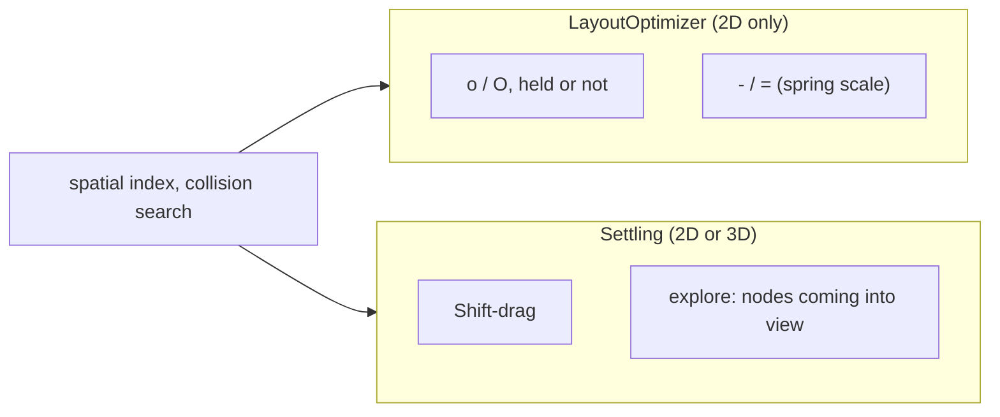
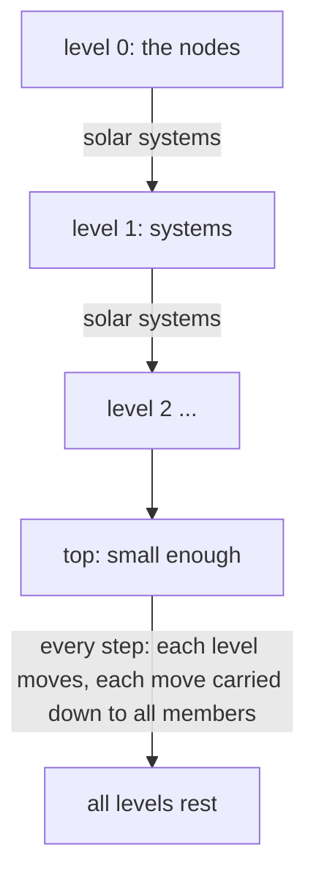

# Springs: one system, its parts, and the features that use it

Status: **specification for review** (2026-10-14). "Now" says what the code
does today; "To be" is the proposal. Numbers marked *(guess)* were chosen
by me and not tuned with Karel. The factors to tune by hand are in
`modules/model/src/commonMain/kotlin/graph_tools/Factors.kt`.

## 1. Today: two spring systems

- `LayoutOptimizer`: one pass = every spring of every moving node,
  averaged, applied in full (times the time share, §3). No damping, no
  weights, no depth.
- `Settling`: steps with damping, weights, pushes before pulls, origins,
  depth in 3D mode. Built for explore, then Shift-drag.

**To be:** one system (the settling). Features differ only in the
parameters of §4, not in code paths.

## 2. The springs

Each spring says, for one node, where it would like to be moved in one
window (§3). In 3D mode all are in space (`Node.point`), nodes counted as
flat cards facing the viewer: the outline across the plane, half the
smaller side deep. In 2D mode they are in the plane and depth never
changes.

| Spring | What it does | Parameters (now) |
|---|---|---|
| **collision** | two nodes nearer than a distance push apart | distance = touching × reach; reach 2 × `spring-scale` (optimizer, explore), 1.15 (Shift-drag: "only off each other") |
| **edge** | the two ends of an edge to a length | length = both reaches toward each other × `spring-scale` × degree factor (1 + 0.2 × larger degree, +1 above 2; the smaller one until Karel 2026-10-16: a hub's leaves crowded it; its own constant in 3D mode, also 0.2: 0.0 was tried, Karel 2026-10-15, and put back; it is in the mass too) |
| **equal siblings** | the edges out of one parent to the same length | half the difference |
| **root** (Karel 2026-10-17) | a root (≥ 3 children, no parent, among those shown; on every level) is to be in its children's middle: v = shortest child edge × mean of the unit ways to the children; the root moves v × 0.1 / window × M / (m_root + M), each child −v × 0.1 × m_root / (m_root + M), M the children's masses (balanced; until Karel 2026-10-17: the root stayed, the children took all, and the pin made the root move instead) | `Factors.ROOT`, `ROOT_LEVELS` |
| **rope** (systems) | an edge's two suns back to no further apart than the path between them laid straight; never pushes | §7 |
| **antigravity** (Karel's original "gravity") | a child pushed on along the way its parent came, kept at its distance | 10 units / window; only for parents with < 3 children; settling: both modes |
| **gravity** | a child pulled to lie from its parent the way the graph's edges go on average | 0.1 of the way / window *(guess)*; Shift-drag only (Karel 2026-10-16: elsewhere it laid all children out one way, in fans) |
| **origin** | back to where it was / where the document has it | at most 40 units / window; counts 0.3 while pushed |
| **follow** (firm origin) | a descendant of dragged nodes to its old place relative to them | 95 % of the way in 2 s; on top of the rest; 0.3 while pushed |
| **across** (3D) | two nodes on each other also go apart across the plane, along (way between them) × (way from parent); siblings to opposite sides | 0.3 of the push *(guess)*; 3D mode only |

## 3. How a step combines them

- **Time.** A spring asks for the move of one window of 16 ms (one
  picture at 60 a second). A step moves for the time since the last one,
  at most a window; a node that waited for its turn catches up, no
  further than its springs ask.
- **Pushes before pulls** (settling): pushes and pulls are averaged
  apart; while a node is pushed its pulls count 0.3.
- **Weights** (settling): of two nodes on each other each takes the
  other's share of their weights: fixed (∞) > heavy 4 > usual 2 > light 1.
- **Damping** (settling): a step moves 0.6 of what is asked, less over
  time (× 0.985 per window); the follow spring does not cool.
  `o` (2026-10-15, Karel) does not cool with time: the part is adaptive
  (Hu 2005): × 1/0.9 (at most 1) after 5 rounds in a row in which the
  springs asked for less (sum of squares), × 0.9 after one in which they
  asked for more; no limit of rounds while pulling. It froze before:
  half the part was gone in some 0.75 s, edges between systems were left
  at 1.65 × the collision distance (now 1.17-1.32), and the upper levels
  stopped at the 200-round limit instead of at rest.
- **Joining**: a node pushed by one that moves joins the moving ones,
  unless fixed.
- **Collisions with the 16 nearest** only (found in a grid as fine as the
  nodes are dense): a pile costs about as much as its nodes, not their
  square.
- **Budget** (Shift-drag, `o`): a step stops after 50 ms; the nodes it took
  move for the others (× all / taken), but by that extra no further than
  their own size.
- **`o` by importance**: (children + 1) × size is both its weight (the
  less important give way) and its order (the most important first).
- **Rest**: when nothing moved more than 0.5 per window over a round and
  no follower is more than 2 from its place; then a last pass that only
  pushes apart (to 1.15 × touching); at most 200 rounds each.
- **Optimizer (now)**: all springs of a node averaged together, applied
  in full; no weights, damping, joining or rest.

## 4. The features

| Feature | Moves | Fixed | Springs | Depth | Ends | Undo |
|---|---|---|---|---|---|---|
| **o held** | selection, or all | the rest | *now:* collision, edge, equal siblings, antigravity | *now:* never | key let go | one step |
| **o not held** (macro, mapping, `:optimize`) | as held | as held | as held | as held | after 20 ms of time | one step |
| **O** on one node | its leaf children | the node, its parents, the rest | as `o` | as `o` | as `o` | one step |
| **O** on several | as `o` | as `o` | as `o` | as `o` | as `o` | one step |
| **Shift-drag** | dragged: exactly with the pointer; followers (descendants with no parent outside): heavy; nodes on them: usual; ghosts: light | — | collision (1.15), edge, equal siblings, origin (back), follow, gravity, antigravity; 3D: across | 3D mode | rest, or another gesture/command (they stop) | one step at rest |
| **explore: nodes coming into view** | them: usual; ghosts in the way: light | pinned nodes | collision (2), edge, equal siblings, origin (where the document has them relative to their neighbours), antigravity | never | rest, at once (not animated) | none (explore) |

Not springs: explore's arrangement of roots in columns, `:set dynamic`'s
columns, the fold onto room walls.

## 5. To be (agreed 2026-10-14; built the same day — §4's "now" columns for `o` are history)

- **`o` on the settling.** Held: a run over the selection (all, none
  selected), one step per picture until the key is let go; not held: 20 ms
  of time at once. Only the selection moves: every other node is fixed
  and does not join.
- **`O` on one node:** the run moves its leaf children; the node and the
  rest are fixed.
- **Springs for `o`:** collision (2), edge, equal siblings,
  antigravity; in 3D mode in space, with across. No origin. (Gravity off
  for `o`, Karel 2026-10-15: it pulls one way only and the graph slid;
  off but for Shift-drag, Karel 2026-10-16: it laid children out in fans.)
- **Antigravity in both modes** for `o` and Shift-drag.
- **3D mode is sparser:** collision and edge distances × 3 (Karel, after 1.5), every feature.
- **Explore in 3D mode settles in space** (with a strong gravity later).
- The optimizer (`LayoutOptimizer`) keeps only what the settling uses from
  it (spring helpers, collision search).

## 6. Questions for Karel

1. ~~`o`: should nodes not selected that the selection runs into make way
   (join as light), or stay fixed as now?~~ **Karel: they stay fixed; only
   the selection moves.**
2. ~~`o` gentler than the optimizer's full pass?~~ **Keep the settling's
   step for now; we will see.**
3. ~~Antigravity in 2D?~~ **In both modes, for `o` and Shift-drag.**
4. ~~3D sparseness?~~ **Yes: collision and edge distances × 1.5 in 3D mode,
   every feature.**
5. ~~Explore in 3D?~~ **Yes, in space. A strong gravity there probably, but
   later.**
6. ~~Gravity 0.1, across 0.3?~~ **Fine for now; tuned by trying.**

`- / =` now change the level of detail: no springs (removed from §4).

## 7. Multilevel: contract, settle, unpack (agreed and built 2026-10-14: `Multilevel`)

Karel: contract clusters until the graph is small, run the springs on it
with volume-based multipliers, carry each cluster's move to its members,
recurse; once the top level settles, continue with the levels below.

Only for `o` on the whole graph (Karel: how collisions would work on a
part of a decomposed graph is unclear).

### Mass (mass first, springs from the masses; Karel's revision)

- **Mass = the room a node wants:** the disc (3D mode: ball) of radius
  its reach × its furthest spring (× 3 in 3D mode), by area (volume);
  it was that radius^d until 2026-10-15 (Karel: fixed, as the shells,
  drawn by area, were √π, in 3D 1.61, times smaller than what the
  springs keep; a system's reach is now the radius of its room); a node's reach averaged over the ways
  (its outline as a square of the same area; in 3D its depth too); its
  furthest spring is the collision's, or the edges' with the degree
  factor of its own degree (Karel: as the springs count children).
- **System:** k × the sum of its members' masses; k = 1.5, a guess, the same in both modes (Karel 2026-10-15: it compounds level by level; 1, and 1.3 for 2D, were tried and put back).
- **Springs from the masses of both ends, one rule on every level:** edge
  length = (reach of one + reach of the other) × spring-scale × degree
  factor of the smaller degree (kept, Karel; the larger since 2026-10-16) (× 3 in 3D); collision the
  same with its touching factor.
  - A real node's reach stays its outline the way the other lies (as
    now): a wide node packs wide. **Nothing changes for real nodes.**
  - A contracted node's reach is the same any way: the reach that wants
    room M (M^(1/d) / (spring-scale, × 3 in 3D)). Its degree is its edges
    on that level; its weight is M.
- Edges between two systems become one, pulling × their count; edges
  inside a system are dropped on that level. (Built 2026-10-15, Karel: the
  count is of the nodes' edges, through all levels; balanced, an edge's
  share is its count among all the counts of the busier end.)
- Two systems with no edge between them keep 1.5 × as far apart as their
  rooms reach (Karel 2026-10-15; 1.5 a guess). On main.dot (2D): edges
  between systems end at 1.0-1.24 × the collision distance (were
  1.17-1.48), the nearest unrelated ones further apart.
- The sparsity spring is not the collision spring (Karel 2026-10-16): the
  collision spring acts on level 0 only; on levels ≥ 1 the sparsity spring
  pushes only two systems near each other with no edge between them (to
  1.5 × as above); two with an edge keep apart by its spring alone.
- Then (Karel 2026-10-16): edges between systems keep their direction
  (a→b and b→a are two edges, each with its own count); the sparsity
  spring skips two systems a directed path of 1 or 2 edges leads between,
  either way, and pushes the others to 3 × their reach.
- Renamed (Karel 2026-10-16): the sparsity spring is the separation
  spring, its factor `Factors.SEPARATION_FACTOR`.

### Clusters: solar systems (after FM3, Hachul 2004, deterministic)

1. **Suns:** walk the nodes by degree, highest first (ties: the heavier,
   then document order; Karel 2026-10-15, for the structure: the hubs are
   the suns; it was edges × mass); a node not within 2 edges of a sun
   becomes one.
   Suns end up at least 3 edges apart; every node within 2 of a sun.
2. **Planets:** neighbours of suns; one next to several suns joins the
   system with the least mass so far (ties: the shorter edge).
3. **Moons:** nodes 2 edges from their nearest sun join through one of its
   planets, by the same rule.
4. **No cap** (Karel: no strict size cap); joining the lightest balances.
5. Levels until the graph has at most 50 nodes *(guess)*, or a level
   keeps more than 0.8 of the nodes below (it does not contract).

### Settling the levels

- Each level runs the settling (§3) on its nodes; a contracted node's move
  is applied to every node it holds, all the way down.
- ~~At rest, the level below becomes the moving one~~ (2026-10-15, Karel:
  all at once): every step moves every level not yet at rest, the top
  first, so a node goes its own way plus that of each system it is in.
  Before a step each stand-in is put back in the middle of what it holds
  (on its sun since Karel 2026-10-16: members torn off into another system
  dragged their own after them, and with `:set suns=1` the graph flew apart).
  On the highest level that moves, each part that hangs together has an
  anchor (most edges, then the heaviest): after each step the anchor's move
  is taken back from the whole part, so a part does not drift, only its
  shape changes (Karel 2026-10-16).
- Which springs act on which level is a table in `Factors.kt` (`EDGE_LEVELS`
  and the rest; Karel 2026-10-16). The edge and equal siblings springs act
  on nodes only: on systems a path of them does not grow with its weight,
  and the graph shrank into one heap.
- **Carried down**, a level at a time: a node of level i gets what the
  systems of level i + 1 moved whose suns are at most 2 edges from it, each
  by 1 / its distance in space; a sun only its own system's. By 1 / the
  edges between them was tried (Karel 2026-10-17) and taken back (Karel
  preferred the distance): main.dot 2D jitter median 2.81 → 2.22, 99 %
  14.9 → 13.6, overlapping pairs 29 → 18; 3D jitter median 5.98 → 6.51,
  99 % 36.3 → 48.9.
- **Level pace** (Karel 2026-10-17): a level's steps, all its springs
  together, times `Factors.LEVEL_PACE(level)` = 1 / (level + 1): upper
  levels settle slower, the lower ones under them. At rest the levels'
  moves add up to none (a system pushed on by its springs each step, its
  sun pushed back by its own), so a level's pace is also its say in the
  shape. main.dot, 600 frames, all levels: 2D jitter 90 % 9.0 → 7.6, 99 %
  22.7 → 14.9, overlapping pairs 44 → 29, edges / wanted median 2.32 → 2.03;
  3D jitter median 7.6 → 6.0, 99 % 51.6 → 36.3.
- **Rope** (Karel 2026-10-16): on systems an edge only pulls, from further
  than its rope. A room's radius is the least space a system needs; the
  most is its path laid straight. Rope of A–B = the shortest of
  d_A(sun, x) + length(x–y) + d_B(y, sun) over the edges x–y between them
  on the level below, d_A by Dijkstra from A's sun among A's members only;
  length = the edge spring's on level 0, the rope above. One search a
  system, each node once a level: about (n + m) log n in all (searching
  level 0 from every sun was up to n · (m + n) log n). A path through a
  third system is missed: a rope may be longer, never shorter. The `o`
  report prints the searches and their time.
  On main.dot (JVM, 16 ms frames) 2D rests in 238 frames instead of 881,
  3D in 399 instead of 1010; the CPU time to rest is about the same.
- **Balanced by mass** (2026-10-15, Karel). The graph slid sideways some
  4400 units a hold: a top system held 907 of 1638 nodes and moved as
  freely as a small one, and each of its moves was carried to all of
  them. Now, on every level (the nodes' too, their mass instead of their
  importance), what two nodes do to each other is shared by mass: each
  moves by the other's part of their masses, edges too.
  - Edges: a node adds them up; each counts as one of as many as the
    busier end has, the same from both ends; it pulls 0.3 while either
    end is pushed. Exactly balanced.
  - Pushes: averaged over the node's own (Karel: "own count"); dividing
    them as the edges left more nodes on each other.
  - Measured (main.dot, 2D, three holds): drift −280 a hold after the
    first instead of −4200; 21-24 pairs on each other instead of 25-30;
    277-286 frames instead of 312-378. The first hold still moves the
    middle of the masses some 1700 (3D 3000), not explained yet.

### Seen (Karel, 2026-10-15)

- While `o` runs by levels, every system of every level is drawn as a wire
  dodecahedron (icosahedron until Karel 2026-10-16: the dodecahedron is tidier;
  2D: a circle; of level 0 only the suns of the lowest since Karel 2026-10-16, the
  planets' are gone; in 3D also a ring of the system's reach, Karel 2026-10-16: R(node)
  = half its longest edge, R(system) = max over members x of d(sun, x) + R(x); of a
  stretched rope the two rings touch at the middle of the edge it goes over) around its sun (was: the mass-weighted middle of what it holds)
  now, as big as a ball (disc) of its mass; each sun of the lowest systems
  in a small one just around that node. Gone when `o` is let go.
- Since: only with `:set suns` (`=<levels>`), while `o` runs and after
  (Karel); level 0 every node's room, the suns coloured, the planets black.

### Open

1. ~~Leaves weigh like their parent~~ (gone with mass first: a node's mass
   is its own room).
2. ~~Which features~~ (`o` on the whole graph). ~~The cap~~ (none).
3. ~~Hubs' room~~ (a node's mass counts its own degree).
4. Edges between two systems are one edge, not yet pulling × their count.
5. Time still to save (2026-10-15, left for now): the nearest-colliders look is about
   a third of a step. Keeping each node's candidates between steps (a Verlet list:
   all within reach + a margin, looked up again once the nodes drifted) was weighed;
   Karel doubts it: early on, while everything moves, the margin would have to hold
   most of the graph.

### Timings

`o` writes, when let go, how long a step of each level took on average, whole and
by phase (order, edge points, index, springs, apply, carry down, reglue), to the
process's standard error (Electron: the developer console). A phase is timed once a
step, not once a node.
