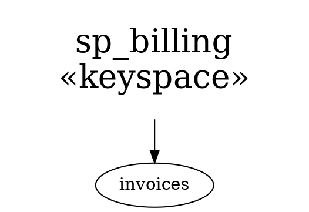

# sane-graph-edit file format

For tools and agents that generate graphs for the editor. The format
is a subset of [Graphviz DOT](https://graphviz.org/doc/info/lang.html);
a file written this way also opens in Graphviz.

## Example



## Structure

- One `digraph <id> { ... }` (or `graph`). No `strict` semantics.
- Statements: node statements `id [attrs]` and edge statements
  `a -> b [attrs]`. Chains `a -> b -> c` work.
- Statement separators: `;` or a newline.
- Attribute lists: `[ k="v"; k2="v2" ]`; `,` also works as a separator.
- **Not supported**: `subgraph` / `cluster`, default statements
  (`node [...]`, `edge [...]` — `node` would become a node named
  "node"), HTML labels, ports (`a:p -> b`).
- Graph-level attributes — `rankdir=LR;` statements or
  `graph [rankdir=LR]` — are not interpreted, but kept on save
  (always written as `key="value";` statements).
- Edge direction: always write `->`. `--` and `<-` are read as `->`
  from the first to the second node.
- Comments: `// ...`, `# ...`, `/* ... */`. Kept on save (a comment
  at the end of a line moves to its own line).

## Identifiers and strings

- Unquoted ids: `[a-zA-Z0-9:._-]+`. Anything else must be quoted.
  (Graphviz itself does not allow `-`, `:` or `.` inside an unquoted
  name, so quote those if Graphviz must read the file too.)
- Quoted strings: `\n`, `\l` and `\r` become a line break, `\"` is a
  quote. Any other backslash sequence is kept as-is (backslash
  included); there is no way to write a lone literal backslash
  followed by `n`, `l`, `r` or `"`.
- Node ids are internal names; the editor may rename them on save.
  Put anything meaningful in attributes.

## Node attributes the editor interprets

| Attribute   | Value | Meaning |
|-------------|-------|---------|
| `label`     | string | Node text; `\n` separates lines. Defaults to the node id. |
| `pos`       | `"x,y!"` | Position of the node centre in editor units (≈ points at zoom 1). **y grows downward** (Graphviz's grows upward — negate it). The `!` is optional on read, always written. Missing → `0,0`. |
| `fillcolor` | `#RRGGBB` | Background. Exactly six hex digits: `#abc` makes the whole file fail to load; named colours don't work either. |
| `color`     | `#RRGGBB` | Text / border colour. |
| `fontsize`  | number | Node size. The editor stores a logarithmic scale `s = log₁.₃(fontsize / 12)`: each step of `s` is ×1.3. Missing → `s = 0` (12). Write `12 × 1.3^s` for a whole step count `s` (e.g. 3 steps → `26.364`). |
| `shape`     | `box` / `oval` | Default `box`. |
| `marks`     | letters | Persistent marks (uppercase `A`–`Z`), recalled with `'<letter>` in the editor. |
| `link`      | path | Link to another file; see below. |

## Custom attributes

Any other attribute on a node or edge (`kind`, `src`, `via`, …) is
kept verbatim across open/save and ignored otherwise. Use plain
names matching `[a-zA-Z_][a-zA-Z0-9_]*` so Graphviz reads them too;
Graphviz ignores attributes it doesn't know.

## `link` — link to another graph

```dot
n1 [ label="invoices"; link="tables/invoices.dot" ];
n2 [ label="docs"; link="/home/me/graphs/" ];
```

- A filesystem path, absolute or relative. A relative path is
  resolved against the directory of the file that contains the node
  (for an unsaved tab: the editor's working directory). `~/` is
  expanded to the home directory. No URLs.
- `gf` (command `follow-file-link`), with exactly one node selected,
  replaces the current tab's graph (asking first if it has unsaved
  changes):
  - a file → opened as a DOT graph;
  - a directory → a file tree of it (as `:browse`), so repeated `gf`
    walks the filesystem.
- `gF` (command `follow-file-link-in-tab`) does the same in a new tab.
- The `:browse` command generates file-tree graphs whose nodes use
  `link`, so it doubles as a file picker.
