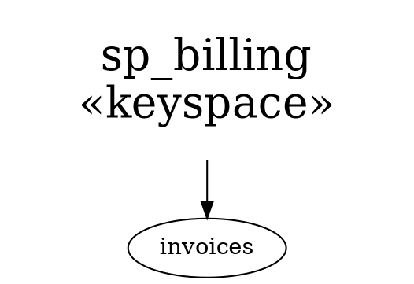

# sane-graph-edit file format

For tools and agents that generate graphs for the editor. The format
is a subset of [Graphviz DOT](https://graphviz.org/doc/info/lang.html);
a file written this way also opens in Graphviz.

## Example



## Structure

- One `digraph <id> { ... }` (or `graph`). No `strict` semantics.
- Statements: node statements `id [attrs]` and edge statements
  `a -> b [attrs]`. Chains `a -> b -> c` work.
- Statement separators: `;` or a newline.
- Attribute lists: `[ k="v"; k2="v2" ]`; `,` also works as a separator.
- **Not supported**: `subgraph` / `cluster`, default statements
  (`node [...]`, `edge [...]` — `node` would become a node named
  "node"), HTML labels, ports (`a:p -> b`).
- Graph-level attributes — `rankdir=LR;` statements or
  `graph [rankdir=LR]` — are not interpreted, but kept on save
  (always written as `key="value";` statements).
- Edge direction: always write `->`. `--` and `<-` are read as `->`
  from the first to the second node.
- Comments: `// ...`, `# ...`, `/* ... */`. Kept on save (a comment
  at the end of a line moves to its own line).

## Identifiers and strings

- The editor reads unquoted ids of `[a-zA-Z0-9:._-]+`; Graphviz only
  `[a-zA-Z_][a-zA-Z0-9_]*` or a number. Quote anything else
  (`"link-d"`, `"my.node"`) so both can read the file. The editor
  writes it that way too.
- Quoted strings: `\n`, `\l` and `\r` become a line break, `\"` is a
  quote. Any other backslash sequence is kept as-is (backslash
  included); there is no way to write a lone literal backslash
  followed by `n`, `l`, `r` or `"`.
- Node ids are kept on save (nodes created in the editor get fresh
  `n<k>` ids), so links can target them (`file.dot:<nodeid>`).

## Node attributes the editor interprets

| Attribute   | Value | Meaning |
|-------------|-------|---------|
| `label`     | string | Node text; `\n` separates lines. Defaults to the node id. |
| `pos`       | `"x,y!"` | Position of the node centre in editor units (≈ points at zoom 1). **y grows downward** (Graphviz's grows upward — negate it). The `!` is optional on read, always written. Missing → `0,0`. |
| `fillcolor` | `#RRGGBB` | Background. Exactly six hex digits: `#abc` makes the whole file fail to load; named colours don't work either. |
| `color`     | `#RRGGBB` | Text / border colour. |
| `fontsize`  | number | Node size. The editor stores a logarithmic scale `s = log₁.₃(fontsize / 12)`: each step of `s` is ×1.3. Missing → `s = 0` (12). Write `12 × 1.3^s` for a whole step count `s` (e.g. 3 steps → `26.364`). |
| `shape`     | `box` / `oval` | Default `box`. |
| `fontname`  | `monospace` (also `mono`, `courier`) | Monospaced text, e.g. for source code; anything else → the default font. |
| `marks`     | letters | Persistent marks (uppercase `A`–`Z`), recalled with `'<letter>` in the editor. |
| `link-<letter>`, `link` | `path[:nodeid]` | Links to other graphs (or nodes), followed with `g<letter>`; see below. |
| `attachTo`, `attachSide` | node id; `above` / `below` / `left` / `right` | Glue this node to another one; see below. |

## Custom attributes

Any other attribute on a node or edge (`kind`, `src`, `via`, …) is
kept verbatim across open/save and ignored otherwise. The editor
interprets no edge attributes at all: `a -> b [via="read"]` keeps
`via`, but edges are always drawn the same way. Graphviz
ignores attributes it doesn't know (quote names that aren't plain
`[a-zA-Z_][a-zA-Z0-9_]*`).

## `attachTo` / `attachSide` — nodes glued to another node

```dot
m  [ label="Billing.charge" ];
m_args [ label="(customer: Id, amount: Money)"; attachTo="m"; attachSide="above" ];
m_ret  [ label="IO[Receipt]"; attachTo="m"; attachSide="below" ];
m_doc  [ label="Charges the card…"; attachTo="m_ret"; attachSide="below" ];
m -> m_args; m -> m_ret;
```

- `attachTo` is the **DOT node id** of the owner (in the file, not a
  generator-internal id). `attachSide` is `above`, `below`, `left` or
  `right`; missing or anything else → `below`.
- The editor keeps an attached node glued to that side of its owner:
  touching it with a 2-unit gap, centred on the owner (horizontally
  for `above` / `below`, vertically for `left` / `right`). Several
  nodes on the same side stack outwards in file order. An attached
  node can be an owner itself (chains); cycles and ids that don't
  exist make the node an ordinary one.
- Its `pos` is **derived**: the editor recomputes it from the owner
  whenever something moves or resizes, and writes the result on save.
  Generators should still write a correct `pos` (other tools read it).
- Moving (drag, grab, rotate, scale, mirror) a selection that contains
  an attached node moves its owner instead, so the group stays
  together. An attached node inherits its owner's visibility (its own
  hidden state doesn't matter). Layout (`:set dynamic` placement)
  treats an owner with everything glued to it as one block: the
  attached nodes are laid out first, and neighbours fan out from the
  block's edges.
- The attached nodes are ordinary nodes otherwise: they have their own
  edges, labels, links, and can be selected (click) and followed. The
  selection-walking commands (`l` / `L`, `t` / `T`, `G`) don't step
  onto them.

## `link-<letter>` — links to other graphs and nodes

```dot
n1 [ label="invoices"; link="tables/invoices.dot" ];
n2 [ label="Billing"; "link-d"="docs/billing.dot"; "link-s"="src.dot:BillingService" ];
n3 [ label="see caller"; link=":n1" ];
n4 [ label="docs"; link="/home/me/graphs/" ];
```

- A node may carry any number of `link-<letter>` attributes, one per
  letter (`a`–`z`, `A`–`Z`). **`link` is an alias for `link-f`**; if a
  node has both, `link-f` wins. Quote the names with `-` for Graphviz.
- Value: `<path>` or `<path>:<nodeid>`.
  - `<path>`: absolute or relative; a relative path is resolved
    against the directory of the file that contains the node (for an
    unsaved tab: the editor's working directory). `~/` is the home
    directory. No URLs.
  - `:<nodeid>` (the part after the last `:`, when it is non-empty,
    has no `/`, and the whole value isn't an existing path): after
    opening, that node (by its DOT id) is selected and centred.
  - An empty `<path>` (`:n5`) means the graph the link is in; so does
    a path to the file that's already open in the tab. Nothing is
    reloaded then, the node is just focused.
  - **Lines of a text file**: when `<path>` is not a `.dot` file and
    the suffix is a number or a range — `src/Billing.scala:42`,
    `src/Billing.scala:40-60` — the link opens a graph with one node
    holding those lines (a single line is a one-line range), being
    edited: what is changed there is written to the file by `:w`. (In a `.dot`
    file a number is a node id.) A path to a file that is not a `.dot`
    file opens all of it the same way. The node's `content-type` names
    the file (see the README).
  - **A section of a markdown file**: `<path>#<heading>` —
    `README.md#Depth` — is the lines from that heading to the next
    one of its level or above, so the link stays right when the file
    changes above it. The heading that is `<heading>` is taken, else
    the first that starts with it, else the first that has it; letter
    case does not matter.
  - `sge:help` is the built-in help, `sge:examples` the index of the
    examples the application writes out when it starts.
- Following, with exactly one node selected:
  - `g<letter>` follows `link-<letter>` in the current tab (asking
    first if it has unsaved changes) — **unless `g<letter>` is mapped
    to something else** (defaults: `gt`, `gT` switch tabs, `gF` below;
    user `:map`s too); then the mapping wins. `gf` is the command
    `follow-file-link` and so works for `link` / `link-f`.
  - `gF` (command `follow-file-link-in-tab`) follows `link-f` into a
    new tab.
  - A file is opened as a DOT graph; a directory is shown as a file
    tree (as `:browse`), so repeated `gf` walks the filesystem.
  - `Ctrl+O` jumps back to where the link was followed from (and
    `Ctrl+I` forward again), like vim's jump list.
- The `:browse` command generates file-tree graphs whose nodes use
  `link`, so it doubles as a file picker.
